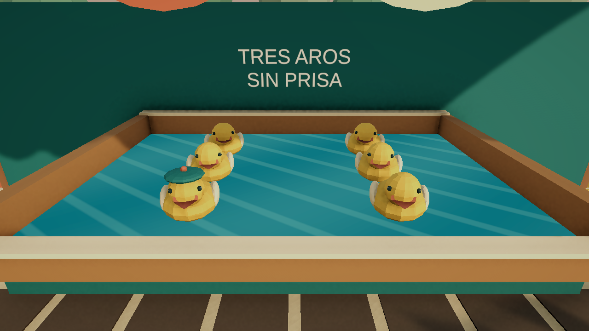

# Después de la feria

Juego independiente para un jugador, Unity 6.3 LTS / C# / URP. Recuperas una feria al amanecer: barres, recoges, limpias y vuelves a encender sus puestos.

## Versión 0.5 — Dos puestos jugables

- **El rincón de las canicas:** 720 residuos, mostrador, cartel y minijuego de lanzamiento con dianas.
- **La poza de los patitos:** 480 residuos en otra distribución, mostrador y cartel; al reactivarla puedes lanzar tres aros a seis patitos móviles. El del gorro vale 100 puntos y los demás 50.
- Viaje entre puestos desde el menú o el cartel de paseo, con transición y progreso independiente. No exige terminar el anterior para visitar el siguiente.
- Guardado de campaña local v2 con respaldo y migración de v1; continúa en el último puesto visitado.
- Limpieza libre en cada zona sin sustituir su progreso ni los récords.
- Confeti de cinco formas, escoba animada y arte original de modelos, carteles, emblemas y escenario.
- Sin cuentas de jugador, servidores, multijugador ni conexión obligatoria.

Los puestos comparten el lenguaje visual de madera pintada, coral, turquesa, marfil y latón. Patitos, aros, agua y cartel de esta versión se crearon para el proyecto. Los juegos de referencia no aportan assets.

## Abrir y jugar

1. Añade esta carpeta a Unity Hub y usa **6000.3.24f1**.
2. Abre PrimeraManana.unity o GaleriaPatitos.unity en Assets/Feria/Scenes.
3. Pulsa Play y entra desde el menú. **Visitar…** cambia de puesto y guarda antes de viajar.

La versión Windows se distribuye aparte, en la carpeta hermana Feria-Windows-v0.5. Conserva los archivos que acompañan al ejecutable.

| Acción | Control |
|---|---|
| Caminar / mirar | WASD / ratón |
| Barrer o limpiar | Mantener clic izquierdo |
| Escoba / paño | 1 / 2 o rueda |
| Mover carrito, colocar cartel, encender, entrar a un juego o seguir el cartel de paseo | E |
| Localizar tarea | Tab |
| Pausa / reanudar | Esc / Enter |
| Guardar | F5 |
| Canicas: lanzar / revancha | E / E o R |
| Patitos: apuntar / lanzar aro | Ratón / clic o E |
| Patitos: repetir tras tres aros | E o R |
| Salir de un minijuego | Esc |

Acerca el carrito a los montones y barre hacia su recogedor amarillo. Limpia el mostrador con el paño. Completa suelo, mostrador y cartel y enciende el puesto. Luego mira la canica o el canal para jugar.

## Guardado y arquitectura

La campaña usa feria-campaign.json en la carpeta de datos del juego del usuario. Cada puesto contiene IDs estables de residuos y superficies. El archivo anterior feria-slot-1.json se conserva: se importa al crear la campaña y las versiones anteriores no actualizan el archivo nuevo. Las preferencias y los récords siguen en PlayerPrefs.

Las reglas y el catálogo son assets; limpieza, carrito, restauración, canicas, patitos y persistencia tienen servicios separados. Consulta [la arquitectura](docs/ARQUITECTURA.md) y [la validación de v0.5](docs/VALIDACION-v0.5.md).

Todavía no incluye economía, mejoras de equipo, campaña comercial completa, Steamworks ni Steam Cloud. La duración y la diversión se evalúan mediante el [protocolo de sesión](docs/PRUEBA-DE-SESION.md).

## Arte y derechos

Fuentes editables en ArtSources; mallas, shaders, PNG y materiales en Assets/Feria/Art/Original; prefabs en Assets/Feria/Prefabs. Los generadores de Editor documentan la autoría reproducible. [Procedencia del arte](ART_PROVENANCE.md).

El repositorio público permite mostrar y versionar el desarrollo. El código y el arte propios no tienen licencia de reutilización abierta; se reservan los derechos del titular del proyecto. Unity, sus dependencias y las fuentes de terceros conservan sus licencias. No se versionan partidas, registros, cachés ni ejecutables.
