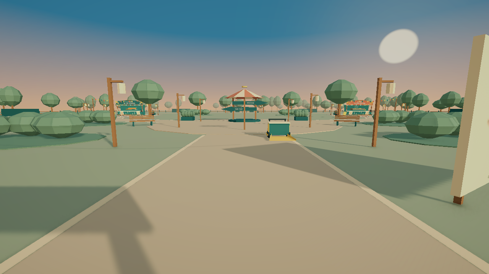

# Después de la feria

Juego indie para un jugador, Unity 6.3 LTS / C# / URP, con guardado completamente local.

## Versión 0.8 — Luz otoñal y sonido ambiental

Las canicas y los patitos están en **ParquePrincipal**, unidos por la entrada, una plaza y un paseo circular. Se camina físicamente entre ellos con un único jugador, carrito y HUD. Cambiar de área actualiza los objetivos sin fundido, transporte ni carga de otra escena.

- Atrio con arco y plano ilustrado, plaza con kiosco, faroles, jardines y merendero.
- Rincón de las canicas y poza de los patitos conservan limpieza, tareas y actividades.
- 1200 residuos en total, con aleteo visual independiente de sus posiciones guardadas.
- Señales físicas hacia los puestos; el menú de pausa ya no ofrece transporte.
- Cuatro parcelas de ampliación con puntos de conexión y accesos físicos cerrados. Son reservas para futuros juegos, no atracciones ya implementadas.
- Guardado v3: una ubicación de jugador/carrito para todo el parque, tareas por atracción y migración del progreso anterior.
- Limpieza libre del parque conserva la campaña y no cambia la ubicación al entrar o salir.

El barrido añade polvo tenue y la recogida un destello breve. Hojas otoñales ligeras y copas con balanceo sutil dan movimiento al parque. Una brisa suave y un leve cambio tonal acompañan el recorrido y el barrido. La cámara aplica un ajuste cálido de color, con contraste y viñeta discretos.

## Alcance y crecimiento

El primer circuito ocupa aproximadamente 104 × 98 m; la definición reserva una envolvente de 200 × 200 m, configurable. La entrada, la plaza, dos atracciones y el paseo posterior son transitables. Los accesos de ampliación están señalizados como jardines en restauración.

La escena no es el parque comercial completo. Las parcelas y definiciones permiten crecer sin rehacer el núcleo; todavía no se implementa carga de sectores ni nuevos juegos en los espacios reservados. [Guía para ampliar el parque](docs/AMPLIAR-PARQUE.md).

## Abrir y jugar

1. Añade esta carpeta a Unity Hub y usa **6000.3.24f1**.
2. Abre Assets/Feria/Scenes/ParquePrincipal.unity.
3. Pulsa Play y Comenzar/Continuar. Camina por los paseos para llegar a las atracciones.

La versión Windows se encuentra en la carpeta hermana Feria-Windows-v0.8. Conserva los archivos que acompañan al ejecutable. Una partida anterior conserva las tareas y aparece junto al último puesto visitado, ahora dentro del parque.

| Acción | Control |
|---|---|
| Caminar / mirar | WASD / ratón |
| Barrer o limpiar | Mantener clic izquierdo |
| Escoba / paño | 1 / 2 o rueda |
| Mover carrito, colocar cartel, encender, entrar a una actividad | E |
| Ayuda para encontrar una tarea o un puesto | Tab |
| Pausa / reanudar | Esc / Enter |
| Guardar | F5 |
| Canicas: lanzar / revancha | E / E o R |
| Patitos: apuntar / lanzar | Ratón / clic o E |
| Repetir patitos después de tres aros | E o R |
| Salir de la vista de una actividad | Esc |

## Guardado y arquitectura

feria-park.json usa formato v3. Guarda jugador, cámara, carrito y herramienta globales, junto al progreso identificado de cada puesto. Al crear la primera partida del parque importa feria-campaign.json de v0.5 o el v1 de las canicas. Los archivos anteriores permanecen disponibles. Para continuar en el parque utiliza v0.8.

ParkSession coordina la escena; cada FairGame conserva limpieza y actividad alrededor de un origen local. Mover o girar la raíz de un puesto no cambia el significado de sus posiciones guardadas. Los límites y la entrada de cada área son configurables.

[Arquitectura](docs/ARQUITECTURA.md) · [Validación v0.6](docs/VALIDACION-v0.6.md) · [Prueba de sesión](docs/PRUEBA-DE-SESION.md) · [Cambios](CHANGELOG.md).

## Arte y derechos

El kit de feria, confeti, herramientas, patitos, aros, carteles, kiosco y caminos se diseñó para este proyecto. Fuentes SVG en ArtSources; mallas, shaders, PNG y materiales en Assets/Feria/Art/Original. Los generadores de Editor reproducen su construcción. [Procedencia del arte](ART_PROVENANCE.md).

Repositorio público de desarrollo con derechos reservados para el código y arte propios; no se ofrece una licencia de reutilización abierta. Unity, paquetes y fuentes tipográficas conservan sus licencias. No se publican partidas, cachés, registros ni ejecutables.
