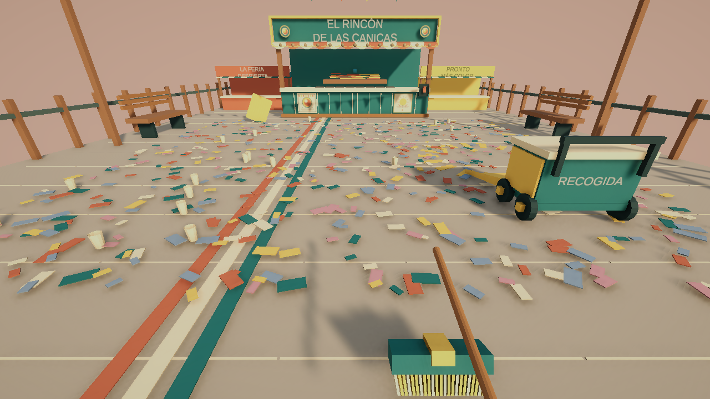

# Después de la feria

Juego independiente para un jugador, desarrollado con **Unity 6.3 LTS / C# / URP**.

Recupera una pequeña feria al amanecer: barre confeti, lleva los residuos al carrito, limpia el mostrador y devuelve un cartel a su sitio. Cuando terminas, el puesto recupera sus luces y puedes soltar una canica en su mecanismo.

## Estado: primera zona jugable, versión 0.2

- Movimiento en primera persona y dos herramientas.
- Barrido con área visible y recogida mediante un carrito movible.
- Ayuda contextual con Tab para encontrar trabajo pendiente.
- Ajustes de sensibilidad y volumen guardados localmente.
- Modelos y gráficos originales: toldo festoneado, banderines, carrito, escoba, paño, carteles e iconos.
- Guardado JSON local con respaldo, recuperación y formato versionado.
- Sin servidores, cuentas de jugador, multijugador ni conexión obligatoria.

Es una zona de prueba; todavía no incluye campaña completa, economía, mejoras, Steamworks ni Steam Cloud. La duración y el equilibrio siguen en evaluación.

## Abrir el proyecto

1. Añade esta carpeta en Unity Hub.
2. Usa **6000.3.24f1**, la versión de `ProjectSettings/ProjectVersion.txt`.
3. Abre `Assets/Feria/Scenes/PrimeraManana.unity`.
4. Pulsa Play y entra desde el menú o con Enter.

Los paquetes se restauran desde `Packages/manifest.json` y `Packages/packages-lock.json`. El repositorio no contiene `Library`, ejecutables, registros ni partidas personales.

## Controles

| Acción | Control |
|---|---|
| Caminar / mirar | WASD / ratón |
| Barrer o limpiar | Mantener clic izquierdo |
| Escoba / paño | 1 / 2, o rueda |
| Mover carrito, colocar cartel, encender, soltar canica | E |
| Localizar tarea pendiente | Tab |
| Pausa / reanudar | Esc / Enter |
| Guardar | F5 |

Coloca el recogedor amarillo del carrito delante de los montones. Limpia el mostrador con el paño. El puesto se enciende al completar las tres tareas.

## Arte propio

Las fuentes vectoriales editables están en `ArtSources/`. Los PNG, materiales y mallas están en `Assets/Feria/Art/Original/`, y los prefabs visuales en `Assets/Feria/Prefabs/`.

El generador `Assets/Feria/Editor/FairArtPass.cs` documenta la construcción de estos elementos. No se utilizaron paquetes de modelos ni ilustraciones descargados para el arte de esta versión. Consulta [ART_PROVENANCE.md](ART_PROVENANCE.md) para distinguir nuestro contenido de las dependencias de Unity y las fuentes tipográficas.

## Documentación

- [Diseño de la primera zona](docs/DISENO.md).
- [Arquitectura y guardado](docs/ARQUITECTURA.md).
- [Cambios y validación](CHANGELOG.md).

## Derechos

Repositorio público para mostrar y versionar el desarrollo. El código y el arte propios no se ofrecen bajo una licencia de reutilización abierta. Se reservan los derechos del titular del proyecto. Las dependencias y fuentes de terceros conservan sus licencias respectivas.
