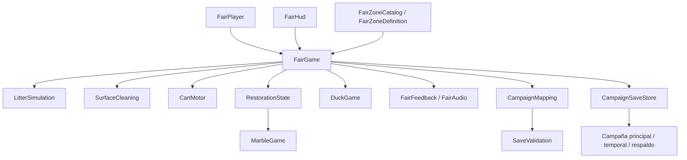

# Arquitectura de Después de la feria — v0.5

Dos puestos ejecutables, dos actividades y campaña local. La economía, mejoras y publicación comercial siguen pendientes.

## Composición

FairGame compone los servicios al abrir cada escena. FairPlayer gestiona entrada, movimiento, herramientas y cámara; FairHud presenta el estado. No hay singleton de campaña ni servicio online.

| Carpeta en Assets/Feria/Scripts | Responsabilidad |
|---|---|
| Raíz | Composición, entrada, HUD y transición |
| Configuration | Catálogo, identidad de zona, escena, actividad, límites y cámaras |
| Simulation | Residuos, superficies y seguimiento del carrito |
| World | Reactivación, canicas y lanzamiento de aros |
| Presentation | Indicadores y audio sintetizado |
| Persistence | DTO v1, campaña v2, mapping por IDs, validación y escritura |
| Diagnostics | Métricas en memoria, sin telemetría |

## Zonas y recorrido

FeriaCatalog.asset contiene RinconCanicas y PozaPatitos. Cada definición incluye zoneId, sceneName, nextZoneId, tipo de actividad, cantidad de residuos/superficies, reglas físicas y pose de cámara. Las escenas son PrimeraManana y GaleriaPatitos. Ambas están incluidas en la compilación.

Visitar desde el menú o mirar el cartel de paseo y pulsar E llama a Travel. Si había limpieza libre, restaura la instantánea de campaña. Se guarda el puesto actual y se registra el destino en la misma escritura. Si falla el guardado, se cancela el viaje. Se cubre la pantalla con una transición marfil y se carga la escena siguiente.

En Windows el primer arranque lee la zona activa y continúa allí. En el Editor se respeta la escena que el desarrollador abrió. El destino debe estar registrado antes de cargarlo para evitar que el arranque devuelva al jugador al puesto anterior.

Cada zona captura su estado inicial antes de cargar progreso. El ensayo de limpieza libre usa esa instantánea; al terminarlo recupera la de campaña. No guarda residuos, tareas ni récords del ensayo.

## Limpieza

LitterSimulation usa posiciones, velocidades, rozamiento y límites, sin un Rigidbody por papel. Las pasadas mantienen una ligera cohesión del montón y el carrito recoge desde la boca. Un umbral de finalización retira los últimos fragmentos para evitar búsquedas minuciosas. La primera zona tiene 720 elementos y la segunda 480.

El aleteo y la inclinación del papel viven en un hijo visual; no se guardan como altura del residuo. SurfaceCleaning lleva las 16 manchas de cada mostrador. CartMotor suaviza el movimiento y consulta obstáculos con una caja reutilizable. RestorationState exige suelo, mostrador y cartel antes de encender luces y habilitar el juego.

## Actividades

MarbleGame mantiene Idle → Aiming → Rolling → Result. El momento de confirmar determina la diana final. No permite reiniciar una bola en marcha; ofrece otra ronda al terminar.

DuckGame mantiene Idle → Aiming → Throwing → Result. El ratón mueve una guía limitada al canal. Confirmar fija el destino y dibuja un arco de vuelo; los patitos continúan moviéndose. Al aterrizar, se comprueba la distancia en el plano del agua, se asignan 100 puntos al patito del gorro, 50 a los demás o 0 al agua. Se muestra brevemente el resultado del aro y el patito reacciona. Tras tres lanzamientos ofrece revancha. No hay reloj ni precio por intento.

Ambos servicios desconocen las teclas y la interfaz. FairPlayer guarda la pose y el campo de visión antes de la vista cercana y los restaura al salir. El estado de pausa detiene medidor, patitos y recorridos. El sonido responde a eventos de recogida, curva, acierto y finalización.

## Campaña v2 y compatibilidad

feria-campaign.json contiene version=2, activeZone y una lista de registros de puesto. Cada registro tiene zona, residuos con ID/posición/retirada, superficies con ID/progreso, carrito, jugador, tareas y tiempo. CampaignMapping convierte el estado en memoria a registros y vuelve a ordenarlos según las identidades de la escena.

Los IDs se serializan junto a las referencias de la escena. Al editar o reordenar un array, cada ID debe seguir asociado a su objeto. Cambiar la cantidad o sustituir identidades requiere una migración de contenido; la versión actual rechaza una distribución incompatible en vez de aplicar progreso a otros objetos. Los generadores crean la distribución original y no deben usarse para renumerar una zona publicada modificada a mano.

Al no existir una campaña, se intenta importar feria-slot-1.json y su respaldo de la primera zona. Se valida el formato v1 de 720 residuos y 16 manchas y se asignan los IDs históricos. El archivo antiguo nunca se modifica ni se elimina. La primera escritura v2 conserva el registro importado y añade el nuevo puesto. Volver a ejecutar v0.4 no actualiza la campaña v2.

CampaignSaveStore vuelve a leer la campaña al guardar y sustituye solamente el puesto actual, conservando los demás. Escribe un temporal y reemplaza el principal con respaldo .bak. Si el principal está corrupto, intenta recuperar el respaldo completo. Si ninguno es legible, bloquea nuevas escrituras. Una versión posterior tampoco se rebaja automáticamente a un respaldo antiguo.

La validación comprueba versión, catálogo, IDs únicos, cantidades, finitud, límites por definición, porcentajes y coherencia de tareas. Una incompatibilidad al aplicar el puesto bloquea su guardado. Los récords de cada actividad, volumen y sensibilidad usan PlayerPrefs. El lanzamiento en curso y los intentos no se persisten.

FairSave permanece como instantánea interna y DTO legado. LocalSaveStore conserva la utilidad de lectura/escritura v1 para compatibilidad y pruebas; la campaña de juego usa CampaignSaveStore.

## Arte y herramientas

Todo el nuevo arte está modelado o dibujado para este proyecto. Las fuentes SVG están en ArtSources; mallas, shaders, PNG y materiales en Assets/Feria/Art/Original; prefabs en Assets/Feria/Prefabs. Unity y las tipografías conservan sus licencias.

FairSceneBuilder sustituye la escena base y solo debe usarse deliberadamente. FairArtPass, FairVisualPolish y FairDetailPolish reproducen las pasadas anteriores. FairDuckZoneBuilder amplía la primera escena con catálogo/cartel y construye la segunda con el mismo kit, patitos, agua, aros y póster originales. Repetir el generador reconstruye sus objetos visuales.

## Verificación y siguientes ampliaciones

FairVerification y FairDetailVerification comprueban los sistemas anteriores. FairJourneyVerification completa limpieza y actividad de ambas zonas mediante acciones simuladas, conservando los archivos de prueba. FairDuckVerification comprueba apuntado, pausa, aciertos/fallos, ronda, récord de práctica y cámara. FairCampaignVerification cubre migración, independencia de puestos, IDs, respaldo, datos inválidos y versiones posteriores.

Las pruebas de Play configuran FairSavePaths con una carpeta aislada mediante SessionState del Editor; esa ruta no existe en el ejecutable. La comprobación de Windows cubre navegación real y reapertura. La validación técnica no demuestra diez minutos de diversión: el protocolo de sesión sigue pendiente de observación humana.

| Ampliación pendiente | Condición |
|---|---|
| Más puestos y tareas, como despegar carteles | Evaluar comodidad de estas dos zonas |
| Economía y mejoras | La interacción básica resulta satisfactoria sin premios |
| Colección y personalización | Contenido original suficiente para coleccionar |
| Cambios de cantidad/IDs en zonas publicadas | Migración de contenido explícita |
| Controles reasignables y accesibilidad | Antes de la demo pública |
| Steamworks y preparación comercial | Sin convertir Steam en requisito del guardado offline |
