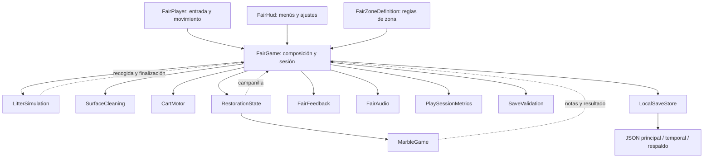
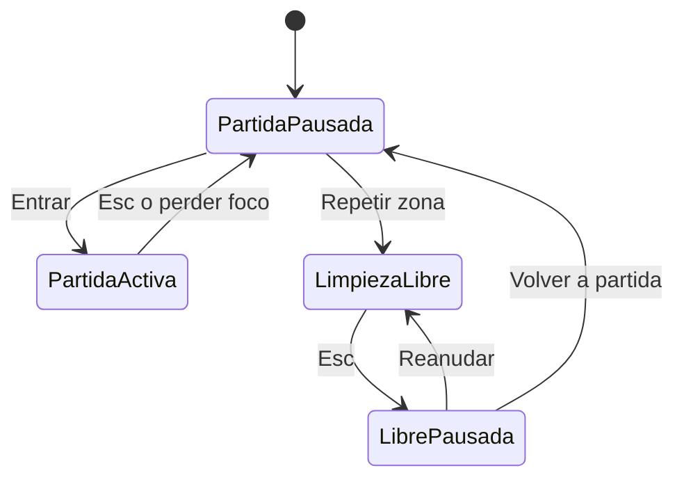

# Arquitectura de Después de la feria — v0.4

Esta es la arquitectura ejecutable de la primera zona y el diseño de ampliación del juego completo. La campaña, economía y Steam todavía no están implementados; se distinguen abajo de los sistemas que ya funcionan.

## Principios

- Un jugador y funcionamiento totalmente local. El repositorio es una herramienta de desarrollo, nunca un servicio necesario para jugar.
- La lógica de limpieza no conoce teclas, menús, sonidos ni archivos.
- Las escenas contienen referencias y presentación. Las reglas ajustables pertenecen a definiciones de zona.
- Se valida toda una partida antes de aplicarla. La limpieza libre nunca escribe progreso de campaña.
- Se mantienen los identificadores de assets mediante sus `.meta`; el arte se crea con fuentes y generadores del proyecto.

## Flujo y dependencias

`FairGame` conserva las referencias serializadas de la escena existente. En `Awake` construye los servicios y conecta sus eventos. Mantiene la API usada por controles y pruebas, delegando la simulación. No hay singleton global, búsqueda continua de servicios ni dependencia de un servidor.

## Organización real

| Carpeta bajo `Assets/Feria/Scripts` | Elementos | Responsabilidad |
|---|---|---|
| Raíz | `FairGame`, `FairPlayer`, `FairHud` | Composición, entrada, cámara y UI |
| `Configuration` | `FairZoneDefinition` | Identidad, límites, herramientas, recogida, finalización y recorrido de canica |
| `Simulation` | `LitterSimulation`, `SurfaceCleaning`, `CartMotor` | Residuos, manchas y movimiento del carrito |
| `World` | `RestorationState`, `MarbleGame` | Restauración y juego de canicas independiente de entrada/UI |
| `Presentation` | `FairFeedback`, `FairAudio` | Indicadores y audio; liberación de recursos temporales |
| `Persistence` | `FairSave`, `SaveValidation`, `LocalSaveStore` | Datos, validación y archivos |
| `Diagnostics` | `PlaySessionMetrics` | Medidas de la sesión en memoria |

Los generadores y verificaciones viven en `Assets/Feria/Editor`. No se ejecutan en el juego compilado. Los modelos, shaders, materiales y gráficos tienen referencias a assets para que Unity los incluya en la compilación.

## Ciclo de vida de una zona

1. Abrir `PrimeraManana.unity` y resolver sus referencias serializadas.
2. Crear servicios con la definición `RinconCanicas.asset`.
3. Capturar el estado inicial del escenario, antes de cargar progreso.
4. Intentar cargar el JSON principal; validar y, si es necesario, recuperar el respaldo.
5. Mostrar el menú. La simulación comienza al entrar.
6. Cada actualización activa coordina carrito, residuos, restauración, audio y medidas.
7. Guardar en los intervalos configurados, interacciones relevantes y salida.
8. Destruir audio y materiales temporales al descargar la escena.

La versión actual tiene una escena jugable. No se añaden escenas vacías de arranque, tiendas o selección de niveles que aún no tienen comportamiento.

## Estados de sesión

La limpieza libre conserva una instantánea de la partida en memoria y restaura la escena inicial. `Save` y el autoguardado quedan bloqueados mientras está activa. Volver recupera la instantánea anterior; salir del programa no sustituye la partida con el ensayo.

Pausar detiene las acciones de juego; no cambia la escala global del tiempo del editor. Las luces, el menú y los controles de preferencias siguen disponibles. El reloj de sesión no impone límites ni penalizaciones.

## Simulación y herramientas

`LitterSimulation` mantiene posiciones, velocidades y estado de retirada para 720 elementos. Usa rozamiento y límites configurables, sin un Rigidbody por fragmento. La escoba combina dirección de pasada y una ligera tendencia a mantener el montón unido. Los vasos y papeles conservan su representación propia.

El recogedor acepta elementos desde su boca. La pared trasera del carro no recoge residuos a través de sí misma. Al alcanzar el umbral configurado, se retiran los últimos fragmentos para evitar una búsqueda minuciosa.

`CartMotor` suaviza el seguimiento, respeta límites y comprueba obstáculos con una consulta de caja reutilizable. No tiene combustible, capacidad ni viajes obligatorios para descargar.

El papel conserva su raíz como posición persistente; un hijo visual lleva el aleteo y la inclinación. No se serializa su altura animada. Los índices de los 720 residuos permanecen intactos.

`SurfaceCleaning` controla las 16 manchas del mostrador. `RestorationState` exige suelo, mostrador y cartel; después activa la luz y habilita el juego de canicas.

`MarbleGame` mantiene las fases `Idle → Aiming → Rolling → Result`. Confirmar durante el apuntado fija la llegada; confirmar mientras rueda no reinicia la bola. El recorrido usa los puntos de la definición de zona y termina en una de cinco dianas (10/50/100). `FairPlayer` guarda la pose de cámara y el campo de visión al entrar, ofrece una vista cercana y los restaura al salir. La pausa detiene el medidor y el recorrido. El movimiento de cámara y los controles no pertenecen al servicio. `RailTouched` y `Finished` alimentan el sonido y la presentación.

## Persistencia y compatibilidad

El formato sigue siendo **v1** para conservar las partidas previas. Se añade `zoneId` de forma compatible: las partidas antiguas sin este campo corresponden a la primera zona. Se rechaza un identificador de otra zona.

La partida contiene posiciones, residuos retirados, limpieza, tareas, carrito, posición/orientación del jugador y tiempo. La validación rechaza tamaños incorrectos, valores no finitos, coordenadas fuera del recinto e indicadores de reactivación incoherentes. Las cotas de compatibilidad actuales corresponden al recinto de la primera zona.

`LocalSaveStore` escribe un temporal y sustituye el principal conservando `.bak`. Prueba principal y respaldo por orden; una recuperación válida repara el principal. Las pruebas usan una carpeta aislada.

Las preferencias de volumen, sensibilidad y mejor puntuación de canicas usan PlayerPrefs, separadas del JSON. Solo un resultado terminado en partida normal actualiza el récord; la limpieza libre no lo modifica. Los intentos y el lanzamiento en curso son efímeros. No se guardan rutas del equipo ni datos personales en el repositorio. Las métricas de sesión permanecen en memoria y no se envían por Internet.

## Arquitectura de ampliación del juego completo

| Sistema siguiente | Contrato previsto | Condición para implementarlo |
|---|---|---|
| Catálogo y cambio de zonas | IDs estables de definición y escena; descargar una zona antes de componer la siguiente | Segunda zona validada |
| Campaña | Estado por ID de zona; tareas obligatorias y opcionales separadas | Más de una zona jugable |
| Economía | Un saldo de vales; recompensa por tareas, compra validada y transacciones guardadas | Herramientas básicas satisfactorias sin recompensas |
| Herramientas y mejoras | Definiciones de herramientas con parámetros; progreso separado de su presentación | Pruebas justifican diferencias jugables |
| Colección y personalización | IDs de objetos y elecciones visuales, sin guardar referencias de escena | Se produce contenido para coleccionar |
| Guardado de campaña v2 | Diccionario por ID de zona y por ID de objeto; migración explícita desde v1 | Antes de distribuir una campaña de varias zonas |
| Steam | Adaptador de plataforma independiente del guardado local y funcionamiento offline | Preparación comercial; no es requisito del prototipo |
| Controles reasignables | Acciones de entrada y preferencias de asignación | Pasada de accesibilidad antes de la demo pública |

Estos sistemas están diseñados como puntos de extensión, no presentados como funcionalidad terminada. No se implementan interfaces vacías ni servicios online preventivos. El guardado por índices de v1 no debe ampliarse a una campaña sin realizar la migración indicada.

## Arte, autoría y construcción

`FairSceneBuilder` construye la zona base; sustituye la escena y debe usarse deliberadamente. `FairArtPass` aplica los objetos e ilustraciones originales. `FairVisualPolish` añade un entorno identificado por su propia raíz, un cielo propio y la definición de zona, conservando los objetos jugables y sus índices.

`FairDetailPolish` se aplica al final para sustituir la representación del papel y la escoba y construir el tablero. Cada pasada es repetible sobre sus propios objetos. Orden de regeneración: base → arte v0.2 → ambiente v0.3 → detalles v0.4. Regenerar la base sustituye la escena; no es necesario para abrir ni jugar.

Los SVG editables están en `ArtSources`. Las mallas, PNG y materiales en `Assets/Feria/Art/Original`; los prefabs en `Assets/Feria/Prefabs`. La fuente y dependencias de Unity conservan sus avisos de terceros.

## Verificación y límites

`FairVerification` comprueba los sistemas y la recuperación del guardado. `FairJourneyVerification` ejecuta barrido y recogida hasta completar el suelo, exige las tareas restantes, comprueba la canica y la protección de la partida al ensayar.

`FairDetailVerification` cubre la separación de aleteo/guardado, entrada/salida, pausa, puntuaciones, repetición, protección del récord y animación de herramienta.

Esta simulación técnica no equivale a una partida humana ni demuestra diez minutos de diversión. El protocolo de observación y sus criterios están en `PRUEBA-DE-SESION.md`.
