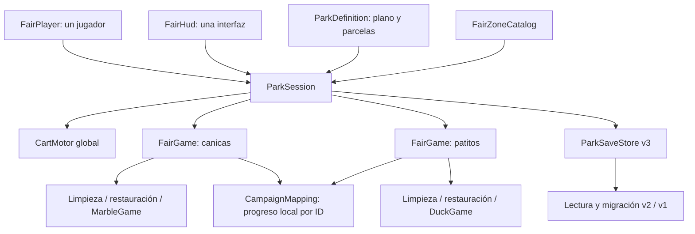

# Arquitectura — parque continuo v0.6

El ejecutable abre una única escena, ParquePrincipal. Canicas y patitos son atracciones dentro del mismo mundo. Las escenas anteriores se conservan como kits y para regresión; no son destinos del recorrido del parque.

## Responsabilidades

ParkSession crea el motor del carrito, asocia los contextos de atracción al jugador/HUD compartidos y carga el parque después de inicializar sus servicios. Tiene orden temprano de ejecución para que los contextos reciban esas referencias antes de Awake.

FairGame conserva sus servicios de residuos, superficies, restauración, audio y actividad. Al pertenecer a un parque delega pausa, guardado, herramienta, práctica y carrito a ParkSession. Las escenas fuente pueden ejecutarse todavía con el comportamiento anterior para verificar compatibilidad.

FairPlayer conserva movimiento y entrada. Sus límites son los globales del parque; no se vuelve a colocar al cambiar de área. FairHud consulta la región actual, mantiene los controles comunes y no crea el botón Visitar en el parque.

## Coordenadas y atracciones

Cada atracción tiene una raíz origin, con escala 1 y una pose propia en el mapa. La primera está desplazada al oeste y girada -12 grados; la segunda al este y girada 12 grados.

- LitterSimulation convierte posiciones a coordenadas locales para límites y guardado; la simulación y recogida se representan en el mundo.
- RestorationState coloca el cartel mediante el origen de su puesto.
- MarbleGame transforma los puntos del recorrido y la diana al mundo. La puntuación usa el desplazamiento local, no la X global.
- DuckGame mantiene apuntado, aterrizaje y trayectorias locales; blancos, guía y aro se representan en el mundo.
- FairPlayer transforma la pose de enfoque y restaura su cámara al salir. El cuerpo no cambia de posición al jugar.

FairZoneDefinition contiene rectángulo de activación, entrada, anclas locales de compatibilidad, reglas, límites y cámara. Por eso una atracción futura puede tener otras dimensiones sin cambiar el controlador del parque.

## Recorrido y áreas

La entrada lleva a una plaza con kiosco. Los caminos frontales se bifurcan hacia los puestos y el paseo posterior los conecta con un descanso/merendero. Las puertas del perímetro son accesos físicos a las áreas reservadas.

RefreshArea comprueba la posición real del jugador en el marco local de las atracciones. Conserva un pequeño margen al abandonar el área para evitar alternar HUDs en el borde. Fuera de una atracción, la interfaz muestra atrio, plaza o paseo; Tab señala la entrada de un puesto pendiente.

Cambiar de área solo cambia contexto y objetivos. No llama a LoadScene, no cubre la pantalla y no modifica pose ni cámara. El carrito mantiene su estado y sigue cruzando el parque, con velocidad de acercamiento limitada y comprobación de obstáculos.

## Persistencia global

feria-park.json tiene version=3 y parkId. Contiene:

- world: una posición y orientación de jugador, inclinación de cámara, posición/orientación de carrito y herramienta.
- zones: registros de atracción con IDs de residuos/superficies, posiciones locales, retirada, limpieza, tareas y tiempo.

Los campos históricos player/cart de cada registro de puesto se mantienen como anclas locales de compatibilidad. La posición física actual se toma exclusivamente de world.

ParkSaveStore valida el parque, posiciones globales y registros de atracción. Escribe un temporal y reemplaza el principal conservando respaldo .bak. Prueba principal y respaldo al cargar. Una partida ilegible o de una versión posterior bloquea la escritura para conservar el original.

Antes de aplicar una partida se convierten y validan todas las atracciones presentes. Después se restauran las tareas y se coloca una sola vez jugador/carrito globales. Un puesto nuevo sin registro usa su estado inicial. Los IDs deben permanecer asociados a sus objetos; cambiar cantidades o sustituir IDs publicados exige una migración de contenido.

## Migración

Si no existe v3, se lee la campaña v2 o se importa el v1 de las canicas. Los residuos y superficies conservan sus IDs y coordenadas locales. El último puesto de v2 proporciona la pose histórica: se transforma mediante su nuevo origen para situar al jugador y al carrito en ese lugar del parque.

La migración normal no sustituye los archivos antiguos. Las versiones v0.5 y v0.4 continúan escribiendo sus formatos, por lo que para seguir el parque se debe usar v0.6. Las preferencias y récords siguen en PlayerPrefs; no se guarda un lanzamiento en curso.

## Práctica

Limpieza libre conserva una instantánea global y reinicia el progreso de las atracciones, manteniendo jugador y carrito donde están. El guardado y los récords quedan bloqueados durante el ensayo. Al volver se recuperan los puestos de la campaña y se mantiene la ubicación física actual.

La pausa detiene la simulación, no la interfaz. No se usa Time.timeScale global para controlar el Editor.

## Crecimiento

ParquePrincipal.asset define la envolvente global y cuatro ParkPlot con IDs, centros, tamaños y puntos de conexión. Los contextos de atracción se descubren bajo ParkSession al iniciar; la interfaz calcula el número total sin fijarlo a dos.

La v0.6 mantiene todas las atracciones presentes en una escena. Una futura partición por sectores necesita registro/desregistro de contextos, progreso retenido de sectores descargados, precarga y pruebas de memoria. Esa carga todavía no está implementada. No se debe desactivar o descargar una atracción publicada y guardar únicamente las restantes.

Añadir otro tipo de minijuego requiere su lógica y presentación. Esta fase prepara el espacio, las coordenadas, la sesión y la persistencia del parque; no incorpora una biblioteca universal de actividades.

## Construcción y arte

ContinuousParkBuilder utiliza los dos kits existentes, extrae jugador/cart/HUD únicos, elimina sus cercas y fondos duplicados y coloca las raíces en el nuevo mapa. Construye entrada, caminos de malla continua, plaza, kiosco, señalética, vegetación, descanso y accesos de ampliación. El relieve bajo se genera fuera de las parcelas y no altera la envolvente de juego de 200 × 200 m; la superficie visual llega más lejos para cerrar el horizonte.

El generador reconstruye la escena y se ejecuta deliberadamente. PolishPaths actúa sobre los caminos y la arboleda originales. La ampliación manual debe mantenerse en los assets/fuentes correspondientes; no se promete conservar ediciones manuales al reconstruir.

Las mallas, materiales, shaders e ilustraciones son propios del proyecto; las fuentes tipográficas y dependencias de Unity conservan sus licencias.

## Verificación

ContinuousParkVerification mueve un CharacterController por el circuito, comprueba pasos de jugador/carrito, áreas y escena única; completa 1200 residuos mediante barrido/recogida, restaura los puestos y prueba las dos actividades giradas. Comprueba cámara, práctica, posición global, migración, respaldo y datos inválidos/versiones posteriores.

Las pruebas de Play usan una carpeta aislada mediante FairSavePaths y SessionState del Editor. Se conservan las pruebas anteriores de v1/v2 y de las escenas fuente. Las medidas simuladas no equivalen a duración de juego humana ni demuestran diez minutos de diversión.

## Pulido integral 0.11

`SurfaceCleaning` conserva los arrays e IDs existentes. Intersecta el plano visible de cada mancha con una tolerancia de 5,5 cm, limita el alcance a través de `FairGame` y comprueba oclusión física. Expone progreso individual y eventos Changed/Completed; no añade un Update por mancha. `FairGame.UseTool` concentra reglas de pausa, herramienta, carrito y área activa.

`FairHud` mantiene un Canvas, escala y zona segura; muestra el objetivo individual y refresca los contadores de objetivos a 6,7 Hz. `FairPlayer.Move` es el mismo recorrido utilizado por input y pruebas; clasifica el suelo solo al generar un paso mediante `FairGroundSurface`. `FairAudio` separa voz de herramientas, pasos e interacciones y enruta fuentes al mezclador; `FairParkAmbience` gestiona ambiente y pausas.

`FairLitterRenderer` dibuja los Transform de la simulación existente con instancing, agrupa por malla/material y usa arrays reutilizados de hasta 1.023 instancias. Conserva los renderers originales y ofrece fallback si la GPU no soporta instancing. Las piezas conservan su movimiento, aleteo, actividad e identificadores. `FairBuildSmoke` solo se instala con -feria-smoke; prueba el arranque en práctica con escritura de campaña suprimida.
