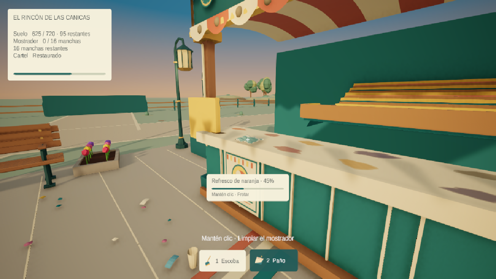

# Pulido v0.12 — Después de la feria

Trabajo local en `polish/v012-assets-tools`, sobre `ParquePrincipal`, sin publicar ni integrar en main. La escena continua, sus dos minijuegos, parcelas futuras y guardado v3 se conservan.

## Recursos y comportamiento

- Escoba original creada en Blender: 1.476 triángulos, mango, empuñadura, cabezal biselado, casquillo y 72 haces de cerdas. Paño original: 1.016 triángulos, pliegues, borde de contraste y espesor de 2,5 mm. Fuentes en `ArtSources/Blender/v012/`, script reproducible y dos FBX/prefabs en `Assets/Feria/Art/Original/ToolsV012/`. Materiales Unity URP separados de los originales FBX. Versiones anteriores conservadas inactivas en la escena.
- Siete familias de manchas: cola, naranja, fresa, jugo, uva, grasa y polvo. Catálogo propio, 32 contornos de derrame deterministas, siete materiales y shader URP con opacidad/rugosidad distintas. Reducción proporcional y alpha siguen el progreso real; los IDs y el formato de guardado no cambian.
- Escoba limitada a 2,8 m medidos desde la cámara. Las salidas anticipadas de pausa, minijuegos, carrito y falta de contacto silencian herramientas.
- Herramientas animadas hacia el punto real de contacto; oscilación y audio conservan su fase compartida. HUD identifica la familia y ajusta el texto largo dentro del indicador.
- Doce árboles en ubicaciones existentes con seis variantes de roble EmbersStorm y dos niveles de detalle; las colisiones de tronco no se animan. Cuatro jardineras de Playground y cuatro barandas de Amusement en los bordes de los puestos. Doce variantes locales reutilizables en `Assets/_Game/Prefabs/Environment/V012/`.
- Se mantienen las bancas, faroles y papeleras originales de v0.11. Sombras del sol suavizadas a intensidad 0,72, sin aumentar las luces dinámicas. Se conservan brisa central, pájaros, partículas reutilizables, bloom y tonemapping existentes.
- Tres clips Kenney CC0 para selección y confirmaciones. Los sonidos de escoba, paño y pasos siguen siendo originales sintetizados; no se presentan como grabaciones reales ni se usan sonidos UI como fricción.

## Comprobaciones

Resultados completos: `receipts/v012-baseline.json`, `v012-qa.json` y `v012-ui.json`. Doce suites verifican importación, materiales/modelos, 2.304 rayos en manchas a progreso 0 y 0,45, alcance, oclusión, pausa, herramienta incorrecta, guardado, migraciones, recorrido físico, restauración, canicas y patitos. HUD comprobado a 1280×720, 1920×1080, 2560×1080 y 720×1280. Vista del Editor restaurada.

La revisión independiente detectó tres problemas: nombre incorrecto al completar y apuntar a otra mancha, frotado fuera del plano al inclinar cámara y ausencia de aviso fuera de alcance. Las correcciones y pruebas de regresión quedan registradas en los recibos finales.

Los tres casos se reprodujeron como fallos y pasaron tras corregirlos (`receipts/v012-review.json`). El paño se comprobó en ocho fases del ciclo a 25°, 45° y 60°. Una copia aislada de la partida v3 anterior recuperó progresos 0/45/100% por ID con los nuevos visuales. Los seis archivos JSON de progreso/respaldo conservan su SHA-256 (`v012-saves.json`).

Compilación final Windows: resultado Succeeded, cero errores, cero advertencias, 118.713.268 bytes; recibo `v012-build.json`. Ejecutable local: `../../Feria-Windows-v0.12/DespuesDeLaFeria.exe`. Arranque nativo D3D12 y captura comprobados durante 152 frames.

En lanzamientos secuenciales a 1280×720, mismo escenario/cámara, 30 frames de calentamiento y 120 muestras, se observaron 4,65 ms de media / 5,82 ms p95 en v0.11 y 1,75 ms / 2,27 ms en v0.12. Es una muestra breve de arranque; no acredita esos tiempos durante diez minutos de juego. Condiciones y líneas originales en `v012-performance.json`.

## Scripts y autoría

| Archivos bajo Assets/Feria | Responsabilidad |
|---|---|
| Scripts/FairGame.cs | Alcance, aviso, etiqueta por ID y salidas que silencian herramientas |
| Scripts/FairPlayer.cs | Poses hacia contacto y frotado en tangentes del mostrador |
| Scripts/FairHud.cs | Nombre de familia, confirmación del objetivo correcto y texto ajustable |
| Scripts/Simulation/SurfaceCleaning.cs | Alpha progresiva mediante propiedades compartidas |
| Scripts/Configuration/FairStainCatalog.cs | Siete perfiles visuales deterministas |
| Scripts/Configuration/FairUiAudio.cs y Presentation/FairAudio.cs | Configuración de clips UI y confirmaciones |
| Editor/FairV012*Builder.cs | Autoría y adaptación de manchas, herramientas y entorno |
| Editor/FairV012*Verification.cs y FairInteractionVerification.cs | Verificaciones nuevas y matriz ampliada de centros/bordes |

La escena guardada es la fuente de las colocaciones finales; algunos ajustes de posición, sombras y barandas se aplicaron mediante comandos del Editor después de los builders. Los paquetes externos se necesitan localmente para resolver sus referencias; no están incluidos como fuentes redistribuibles en el commit.

## Procedencia y límites

Inventario con hashes: `receipts/v012-assets.json`; licencias: `THIRD-PARTY-ASSETS-v012.md` y `superpowers/inspections/2026-11-02-v012.md`. Los paquetes externos fuente permanecen locales; su uso integrado no se trata como permiso de redistribución pública. No se compraron assets, consumieron créditos ni instalaron dependencias. Los cambios previos del usuario en paquetes, ajustes y fuentes permanecen separados.

Se eligió conservar los diseños originales de mobiliario y el foley sintetizado donde ya existían. La comodidad durante diez minutos, la calidad percibida del audio y la composición artística requieren jugar y escuchar la versión. Las pruebas automatizadas no sustituyen esa valoración. El conteo de variantes no prueba por sí solo calidad visual ni despeje de todas las parcelas; el recorrido comprueba los trayectos existentes.

El HUD se implementó directamente en uGUI. Se conserva un diseño SVG original en `ArtSources/UI/v012/limpieza.svg`; no se afirma haber creado un archivo Figma. Sus herramientas aparecieron al final de la sesión y se mantuvo el flujo nativo ya implementado.

## Decisiones de ejecución

Se trabajó en el checkout y rama local aprobados para utilizar el Editor abierto y los paquetes sin commit del usuario. El registro se llevó con herramientas nativas de Windows. Se conservaron el encogimiento proporcional anterior, el mobiliario propio y el ambiente central; no se añadió un nuevo efecto de oclusión ni paquetes de audio sin licencia verificada. Publicación e integración siguen fuera de esta entrega.
