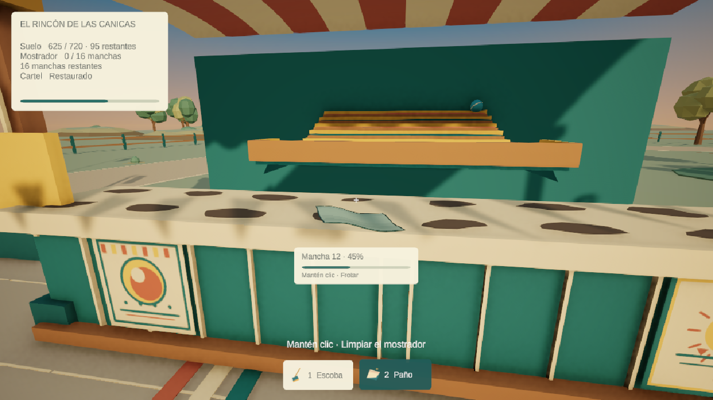
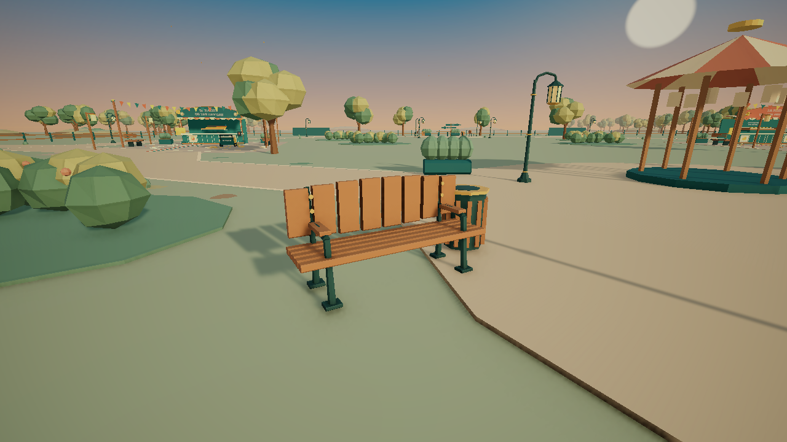
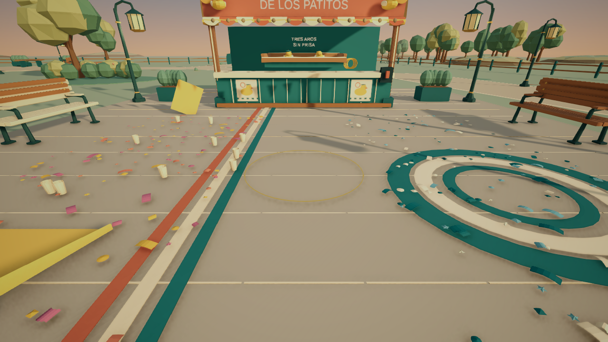

# Pulido integral 0.11 — Después de la feria

Implementación sobre `ParquePrincipal`, Unity 6000.3.24f1 / URP. Respaldo Git: rama `recovery/pre-integral-v011`; trabajo en `polish/integral-v011`. Se conservan la escena continua, los dos juegos, los 1.200 residuos, las cuatro parcelas de ampliación y el formato local v3.

## Diagnóstico y corrección de interacción

Antes, el paño usaba el impacto de `Physics.Raycast` en el collider del mostrador y lo comparaba con una esfera de 36 cm alrededor del centro de cada mancha. Esa superficie de colisión estaba por debajo de la malla visible y la esfera no representaba su silueta. La detección tampoco exponía un objetivo individual al HUD.

`SurfaceCleaning.Raycast` ahora intersecta el plano de la malla visible, comprueba sus límites transformados y añade un margen de 5,5 cm. Ese margen se mantiene al reducirse la suciedad para evitar terminar buscando un punto diminuto. El alcance es de 3,5 m; una comprobación física rechaza oclusiones. Los triggers se ignoran. Los objetos sólidos, incluido el interruptor que tapa parte de un extremo desde ciertos ángulos, conservan su bloqueo físico.

`FairGame.UseTool` aplica las condiciones de herramienta, pausa, carrito, minijuego y zona antes de avanzar el objetivo. La escoba no limpia manchas. Soltar el clic detiene el progreso. No se añadieron componentes con `Update` por mancha.

## Limpieza, contadores y guardado

- Se mantienen los dieciséis IDs y valores independientes por mostrador; no cambian rutas ni versión JSON.
- El servicio expone progreso, cantidad completada y eventos `Changed` / `Completed`.
- La representación se reduce proporcionalmente y desaparece al llegar a 100%.
- El indicador contextual muestra mancha, porcentaje, herramienta necesaria y confirmación breve al completar.
- La interfaz cuenta residuos recogidos/total/restantes, manchas completas/restantes y estado del cartel. En los caminos muestra el conjunto del parque.
- El destello de completado reutiliza un sistema de partículas y un sonido discreto.

## HUD

Se adapta el `FairHud` existente: un Canvas y un EventSystem, TextMeshPro, panel crema con esquinas suaves, acentos petróleo, barra global y dos tarjetas con iconos de herramienta. El indicador individual aparece debajo del punto de mira; el centro queda libre para ver la superficie y el paño. Las imágenes decorativas no reciben raycasts; botones y sliders sí.

Canvas Scaler, anchors y zona segura mantienen la colocación. La tarjeta de pausa se reduce si falta espacio. Los contadores de objetivos se refrescan a intervalos de 150 ms; el progreso contextual se suaviza cada frame. Se comprobaron 1280×720, 1920×1080, 2560×1080 y 720×1280, además de los tamaños libres del Editor. Las resoluciones temporales de comprobación se retiraron al terminar.

## Arte original y prefabs

Modelado procedural propio en metros; geometría biselada, perfiles octogonales y materiales compartidos URP. No se descargaron assets ni se instalaron paquetes. La herramienta local `game-dev` no está disponible, por lo que la autoría, integración y comprobación se realizaron con Unity nativo.

| Prefabs en `Assets/Feria/Prefabs/ParqueArtesanal` | Diseño y uso |
|---|---|
| `Banco_0`, `Banco_1`, `Banco_2` | Listones biselados, respaldo horizontal o vertical, brazos curvos, patas con zapata, herrajes y versión marfil; 8 ubicaciones |
| `Farol_0`, `Farol_1` | Base escalonada, poste fino, brazo curvo, jaula octogonal, remates de latón y papel cálido; 22 ubicaciones entre paseos y puestos |
| `Arbol_0`, `Arbol_1`, `Arbol_2` | Troncos ramificados, copas anchas o verticales, dos tonos y LOD; 98 ubicaciones |
| `Arbusto_0`, `Arbusto_1`, `Arbusto_2` | Masas de distintas alturas y pequeñas flores; 32 ubicaciones |
| `Papelera` | Cuerpo octogonal, listones, aro de latón y collider; cuatro ubicaciones |
| `Pano_Artesanal` | Tela fina de dos caras, pliegues y dobladillo; reemplaza la representación rígida del paño |

Las mallas y los materiales se guardan en `Assets/Feria/Art/Original/ParqueArtesanal`. Las bancas y faroles tienen colliders simples; los árboles usan cápsulas en el tronco. Las copas y las flores no añaden obstáculos. Los diseños originales reemplazados quedan inactivos para recuperación. No se reconstruyó la escena completa.

Las cuatro bancas laterales de los puestos se instancian con escala unitaria y orientación hacia el recinto. No heredan la escala aplastada del antiguo asiento cúbico. Los cuatro bancos del paseo conservan sus raíces originales. Una comprobación específica evita repetir ese error de escala.

Mesa, jardineras y postes del perímetro reciben bordes biselados sin cambiar sus colliders o poses. Los caminos y explanadas tienen metadatos de suelo; los paseos de malla incorporan colisión para identificar correctamente la superficie. Los puestos, el carrito, los carteles y las mecánicas existentes conservan sus referencias.

## Audio, animaciones y efectos

`FairAudio` genera tres variantes por superficie para piedra, madera, tierra y césped. El paso depende del desplazamiento horizontal real y del contacto con el suelo. El clasificador de suelo se consulta al emitir un paso. Se comprobaron aceleración, frenado, reposo, aire y pausa con el mismo método `FairPlayer.Move` utilizado por el input.

La escoba y el paño conservan sus timbres separados, con fricción y ruido filtrado en lugar del componente tonal del barrido anterior. El movimiento de la herramienta sigue la fase de su clip, se activa al haber contacto y transiciona a reposo al cesar. La escoba se recoge hacia un lado en reposo; el paño se acerca al punto de limpieza y frota con un movimiento propio. El balanceo de cámara sigue siendo pequeño.

`Resources/FeriaAudio.mixer` contiene grupos Herramientas, Pasos, Interacciones y Ambiente. Herramientas/pasos usan audio 2D; las campanillas del puesto incorporan distancia espacial. La pausa detiene herramientas, pasos y ambiente. Las fuentes de brisa y pájaros tienen filtros independientes. El volumen maestro continúa en los ajustes existentes. Todos los sonidos son procedurales originales; no son grabaciones de foley.

Se reutilizan polvo y destellos; copas y banderines se animan de forma central. Se conserva el shader de agua pintada de los patitos. No hay un controlador por residuo. La luz principal se ajusta suavemente a un tono cálido y la cámara usa SMAA medio. Los faroles nuevos emplean emisión sin añadir luces dinámicas.

## Archivos y responsabilidades

| Archivo | Cambio |
|---|---|
| `Scripts/Simulation/SurfaceCleaning.cs` | Plano visible, tolerancia, oclusión, progreso individual y eventos |
| `Scripts/FairGame.cs` | Objetivo contextual, contacto, reglas de herramienta, completado y sonido |
| `Scripts/FairHud.cs` | Contadores, tarjetas, indicador individual, zona segura y escalabilidad |
| `Scripts/FairPlayer.cs` | Movimiento comprobable, selección, superficie y poses sincronizadas |
| `Scripts/Presentation/FairAudio.cs` | Variantes, mezcla, pausa y separación de fuentes |
| `Scripts/Presentation/FairVfx.cs` | Completado, ambiente en pausa, viento central |
| `Scripts/Presentation/FairLitterRenderer.cs` (nuevo) | Dibujo instanciado de los Transform de la simulación existente; arrays reutilizados y fallback |
| `Scripts/World/FairGroundSurface.cs` (nuevo) | Metadatos estáticos de superficie, sin Update |
| `Editor/FairEnvironmentPolish.cs` (nuevo) | Autoría de modelos/prefabs e integración conservando objetos y referencias |
| `Editor/FairInteractionVerification.cs` (nuevo) | Casos de clic y pruebas negativas |
| `Editor/FairMovementVerification.cs` (nuevo) | Caminata, pasos y pausa |
| `Editor/FairPresentationVerification.cs` (nuevo) | Canvas, resoluciones, prefabs, grupos y LOD |
| `Scripts/Diagnostics/FairBuildSmoke.cs` (nuevo) | Comprobación optativa de Windows, práctica sin escritura de campaña y captura |

Las rutas de la tabla son relativas a `Assets/Feria`. También se actualizan `ParquePrincipal.unity`, documentación, procedencia del arte y versión del producto. Los identificadores locales de Unity Cloud quedan fuera del commit.

## Pruebas realizadas

- Seis suites pasadas: parque continuo, interacción, movimiento, presentación, pulido y campaña. [Resultados](receipts/v011-qa.json).
- 5.497 pasos físicos en el recorrido final; jugador y carrito cruzan las zonas sin saltos ni cargas de escena.
- Limpieza de los 1.200 residuos por barrido/recogida, dos mostradores, carteles, luces y restauración.
- Canica y tres aros en atracciones desplazadas/giradas.
- 1.152 rayos sobre centros y bordes, tres distancias y tres ángulos. Los rayos físicamente ocultos se esperan rechazados; no se contabilizan como accesos válidos.
- Herramienta equivocada, pausa, fuera de alcance y pared interpuesta rechazados; mantener, soltar y mover la cámara conservan el progreso esperado.
- Recarga de progreso parcial/completo; guardado v3, migraciones v1/v2, respaldo, duplicados, datos no finitos y versiones posteriores protegidos.
- Un Canvas, un EventSystem, grupos de audio asignados, prefabs con mallas y colliders y 98 LODGroups.
- Conteo de dibujo: 575 residuos visibles y 575 esperados en la partida usada, distribuidos en 61 lotes. El ciclo completo también se volvió a ejecutar con el renderer instanciado.
- Última sesión limpia del Editor: cero errores y cero advertencias. Las capturas se inspeccionaron visualmente.

## Rendimiento medido y sus límites

Misma vista de entrada a 1096×660; 30 frames de calentamiento y 180 muestras mediante `ProfilerRecorder` y `UnityStats`. [Datos](receipts/v011-performance.json).

| Medida en Editor | Antes | Final |
|---|---:|---:|
| Llamadas de dibujo, media | 5.717,76 | 4.138,92 |
| Asignación GC por frame, media (bytes) | 10.906,30 | 10.532,69 |
| Tiempo de frame, media (ms) | 11,63 | 16,44 |
| Tiempo de frame, percentil 95 (ms) | 12,15 | 17,05 |

Las llamadas de dibujo se reducen un 27,6%. El tiempo total por fotograma **no mejoró en estas muestras**: incluye el Editor, sus esperas y el control de la ventana, y no permite atribuir una ganancia de FPS a la reducción de llamadas. Se aplicaron LOD a las copas lejanas y lotes de GPU a los residuos; esto mantiene sus objetos, identidades, simulación y persistencia. Los límites de dibujo de cada lote se calculan a partir de su atracción para admitir futuros emplazamientos. No se afirma certificación de rendimiento en equipos de gama media ni ausencia de toda asignación GC.

## Windows y ejecución

La escena de entrada de la compilación es `ParquePrincipal`. El paquete se genera en la carpeta hermana `Feria-Windows-v0.11`; conservar ejecutable, carpeta de datos y DLL que lo acompañan. La comprobación de compilación y arranque se registra en `receipts/v011-build.json`.

En Unity: abrir `Assets/Feria/Scenes/ParquePrincipal.unity`, Play y Comenzar/Continuar. En Windows: abrir `DespuesDeLaFeria.exe`. WASD caminar, ratón mirar, 1 escoba, 2 paño, clic mantenido usar, E interactuar, Tab orientación, Esc pausa, F5 guardar.

## Pendiente de valoración humana

Las pruebas programadas no sustituyen una sesión humana de diez minutos, una escucha crítica del sonido ni una prueba prolongada en varios equipos. El timbre procedural de los pasos y el nivel de movimiento de herramientas pueden requerir ajuste según esa valoración. El parque mantiene su distribución grande actual; esta fase no añade atracciones ni mecánicas.

## Resultado final de Windows

Compilación `Succeeded`: cero errores, cero advertencias, 116.070.441 bytes y 15,07 s según Unity. Arranque del ejecutable con salida 0 y 152 frames; captura de cámara producida e inspeccionada, con confeti, bancas y faroles nuevos visibles. Se conservaron sin cambios de bytes los seis archivos de partida/respaldo controlados.

Comprobación breve en práctica con 1.200 residuos iniciales, Direct3D 12, 1280×720 y NVIDIA RTX 3050 Laptop GPU de 4 GB: media 3,63 ms y percentil 95 de 4,75 ms durante 120 muestras tras 30 frames de calentamiento, con ventana oculta. Esta medición de arranque no se compara directamente con la del Editor ni certifica FPS durante una sesión prolongada.

