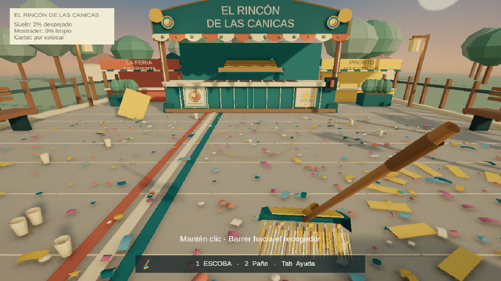
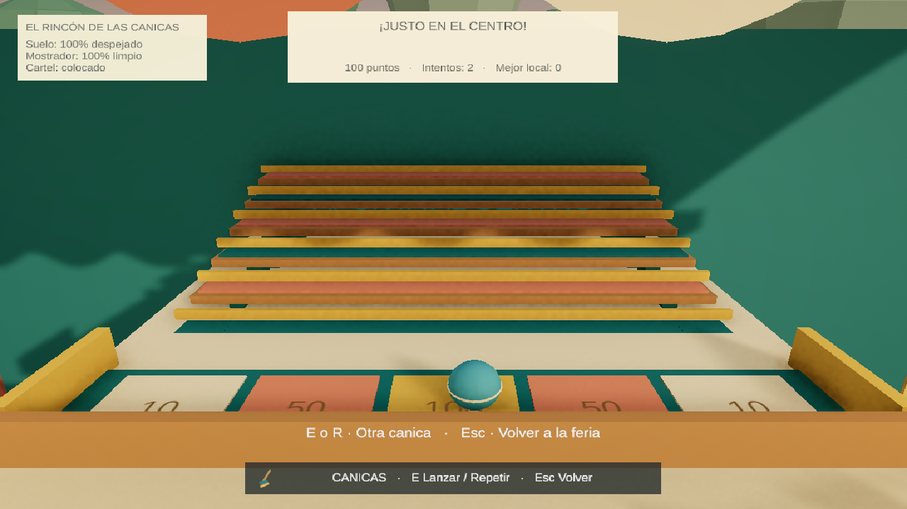

# Validación v0.4

Fecha: 30 de octubre de 2026. Unity 6000.3.24f1, Windows 64 bits, URP.

## Resultado técnico

- Compilación C# sin errores ni advertencias.
- Windows: Succeeded, 0 errores y 0 advertencias; 34.603 segundos de compilación.
- Ejecutable abierto y representación de la escoba, el escenario y la interfaz inspeccionada. Sin excepciones administradas ni errores de shader en Player.log.
- Se comprobó avance real de fotogramas en Play mediante Time.frameCount.

## Pruebas ejecutadas

FairVerification: 8 grupos correctos — barrido/desplazamiento, recogida, ayuda contextual, tareas/luces/canica, restauración visual, preferencias, referencias/mallas/normales y guardado con recuperación.

FairJourneyVerification: el ciclo completo recogió los 720 residuos mediante pasadas y el carrito en 2213 pasos simulados de 20 ms. Exige mostrador/cartel, reactiva el puesto, llega a la diana y conserva el archivo aislado de campaña durante la limpieza libre. Rechaza identidad de zona distinta.

FairDetailVerification: 4 grupos correctos. Papel curvado con aleteo separado de las posiciones guardadas; entrada, medidor, pausa, bloqueo de reinicio durante el recorrido y salida con cámara restaurada; cinco lanzamientos con resultados 10/50/100/50/10 y revancha; récord protegido en práctica; movimiento de cabezal y fibras.

También se confirmó la transición de apuntado a recorrido a través de un estado de teclado del Input System y la lectura de FairPlayer. Las pruebas de lógica/entrada son sintéticas; no se presentan como una sesión humana de teclado y ratón.

Las pruebas usan instantáneas, supresión de guardado y, para verificar escritura/recuperación, archivos aislados. Los índices y el formato JSON v1 siguen siendo compatibles. El récord usa PlayerPrefs y solo cambia al terminar una ronda en la partida normal.

## Revisión visual

Se corrigió un encuadre inicial donde el toldo ocultaba el tablero. El medidor queda arriba y las cinco dianas permanecen visibles. Las mallas de papel tienen dos caras con normales separadas; las fibras se agrupan en una malla de tres materiales. Las sombras del confeti están desactivadas para evitar sombras duras desproporcionadas sobre papel pequeño.

## Comprobación de juego pendiente

Esta validación no demuestra diez minutos de diversión. El protocolo PRUEBA-DE-SESION.md sigue siendo la comprobación de comodidad y deseo de repetir. Probar primero limpieza libre y después varias rondas de canicas: observar si apetece otra pasada o un lanzamiento adicional sin dinero ni mejoras.
