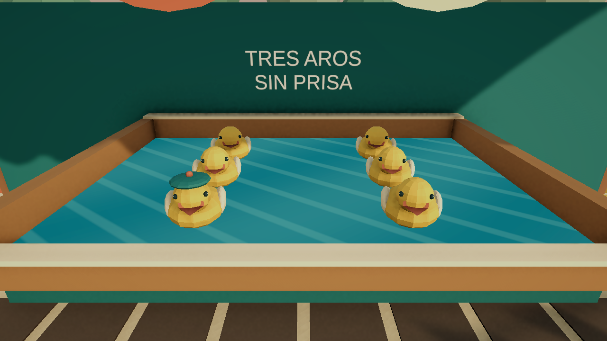

# Validación v0.5

30 de octubre de 2026. Unity 6000.3.24f1, Windows 64 bits y URP.

## Resultado

- C# compila sin errores ni advertencias.
- Windows: Succeeded, 0 errores y 0 advertencias; 60.759 segundos. Incluye las dos escenas.
- Juego abierto: migración del puesto de canicas terminado; visita a patitos, regreso conservando las canicas y nueva visita.
- Cierre y reapertura: continúa en los patitos con la campaña local.
- Avance real de fotogramas comprobado en Play.

## Pruebas

- Campaña: 4 grupos correctos. Migra v1 sin alterar el archivo anterior; conserva progreso distinto en dos puestos y destino activo; recupera respaldo; rechaza IDs duplicados, posiciones no finitas y versiones posteriores sin sustituirlas. El mapping conserva los objetos al reordenar sus identidades.
- Primera zona: 8 grupos de sistemas, 4 de detalles y ciclo completo de 720 residuos, recogidos mediante pasadas/carrito en 2213 pasos simulados de 20 ms. Tareas y canica correctas.
- Segunda zona: 4 grupos de patitos y ciclo completo de 480 residuos en 1650 pasos simulados. Exige tareas antes de reactivar y completa tres aros al patito del gorro.
- Patitos: apuntado limitado al canal, pausa, acierto de 100, fallo de 0 y acierto de 50; bloqueo de doble lanzamiento, revancha, récord protegido en práctica y cámara restaurada.
- Ratón: una entrada sintética del Input System pasó por FairPlayer y cambió la actividad de Aiming a Throwing.
- Viaje de ida y vuelta en Play: conservó avances parciales distintos, con un único EventSystem tras la carga.
- Inspección visual: se bajó el borde frontal para mostrar los patitos, se distinguió la guía de los adornos del agua y se colocó el letrero fuera del medidor.

Los archivos de pruebas automáticas se guardan en work, fuera del repositorio. En la comprobación de migración de Windows se conservó el archivo v1 original y se creó la campaña v2 normal. No se publica ninguna partida personal.

## Alcance

Las pruebas son técnicas y sintéticas, salvo la inspección y navegación de Windows. No prueban diversión sostenida, rendimiento en otros equipos ni todas las condiciones de disco lleno. La prueba de comodidad y deseo de repetir sigue el protocolo PRUEBA-DE-SESION.md.

La siguiente imagen es una vista limpia del arte de la escena, sin HUD; las capturas de funcionamiento se inspeccionaron por separado.

