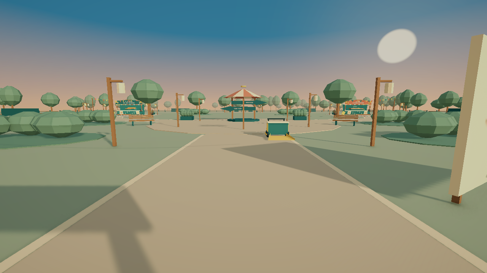
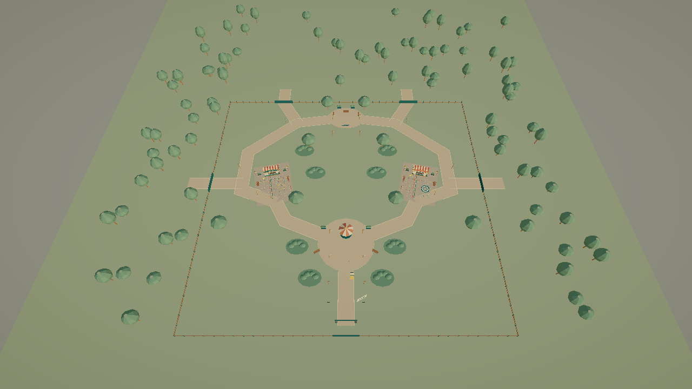

# Validación v0.6

30 de octubre de 2026. Unity 6000.3.24f1, URP y Windows 64 bits.

## Resultado técnico

- Compilación final de Windows: Succeeded, 0 errores y 0 advertencias; 31.375 segundos.
- Solo ParquePrincipal está en las escenas del ejecutable. Las dos escenas anteriores permanecen como kits de edición y regresión.
- El ejecutable abrió la partida migrada: canicas completas y avance de patitos conservado.
- Se comprobó el botón de guardar: creó feria-park.json v3 con jugador y carrito globales y los dos registros de atracción. La campaña v2 anterior quedó idéntica.
- Player.log inspeccionado sin excepciones administradas ni errores de shader.
- Se detuvo el control de ventanas mediante Esc antes de hacer una segunda reapertura de Windows. La reapertura del formato v3 sí se comprobó en Play del Editor.

## Pruebas ejecutadas

ContinuousParkVerification: cinco grupos correctos. Una escena con jugador, carrito, HUD y AudioListener únicos; cuatro parcelas; movimiento real de CharacterController y detección de áreas; limpieza y actividades con raíces desplazadas y giradas; práctica y persistencia.

El recorrido acumuló 5495 pasos simulados: entrada, canicas, plaza, patitos y vuelta por el paseo posterior. El carrito acompañó el tramo inicial hasta canicas. Se comprobaron desplazamientos por paso, salida de los límites de los antiguos recintos y permanencia de una sola escena. El recorrido volvió a pasar tras pulir caminos y añadir los árboles de sombra.

Se recogieron los 1200 residuos mediante barrido y carrito en 4100 pasos de simulación. Las tareas colocaron sus carteles respecto al origen de cada puesto; canicas y patitos funcionaron girados. Una bola central obtuvo 100 puntos y tres aros al patito del gorro obtuvieron 300. El enfoque de actividad conservó la posición del cuerpo y restauró la cámara al salir.

La práctica reinició/restauró los puestos sin cambiar el lugar del jugador. El almacenamiento aislado comprobó migración v2, posiciones globales, respaldo, posiciones no finitas y protección de versiones posteriores.

Una entrada sintética W pasó por FairPlayer y recorrió el parque más allá del límite Z de las escenas antiguas. También se comprobó un rectángulo de atracción más ancho, configurable sin cambiar el controlador.

Regresión: FairCampaignVerification pasó sus cuatro grupos; FairVerification pasó ocho; FairDetailVerification pasó cuatro y FairJourneyVerification completó la primera escena fuente. Las mallas originales nuevas conservaron normales válidas.

## Alcance

Las pruebas de recorrido y actividad son sintéticas, no una afirmación sobre duración o diversión humana. Los archivos automáticos están en work, separados de las partidas reales. El circuito y la persistencia funcionan; siguen pendientes la evaluación de comodidad y las mediciones de rendimiento en otros equipos. No hay streaming implementado ni cuatro minijuegos nuevos: las parcelas son reservas de ampliación.

Las imágenes son vistas limpias de la escena, sin HUD; la vista aérea omite temporalmente la niebla para facilitar la lectura del plano.

